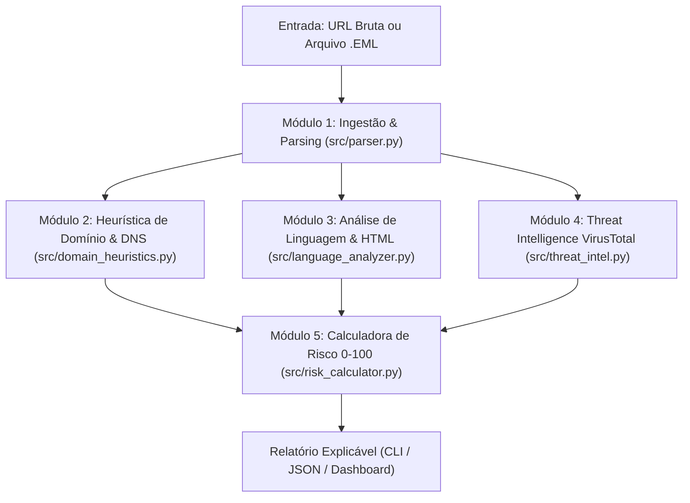

# 🛡️ Fishing Tracker — Motor Modular de Detecção de Phishing

Ferramenta em **Python** para triagem automatizada e análise heurística de **URLs** e **arquivos de e-mail (`.eml`)** em busca de indicadores técnicos de *phishing*: **typosquatting**, **ataques homógrafos (Punycode)**, **falhas de autenticação (SPF/DKIM/DMARC)**, **engenharia social (senso de urgência)**, **links camuflados** e **reputação externa via VirusTotal API v3**.

---

## 📐 Arquitetura e Fluxo de Análise



---

## 🧰 1. Tech Stack Principal (Motor de Análise)

- **Linguagem Base (`Python 3.11+`)**: Manipulação nativa de e-mails (`email.policy`), expressões regulares de alta precisão (`re`), concorrência assíncrona e tipagem estática (`dataclasses` + *type hints*).
- **Expressões Regulares (`Regex`)**: Extração de URLs, endereços IPv4/IPv6 literais, cabeçalhos de autenticação (`Authentication-Results`), gatilhos de engenharia social e links HTML camuflados (`<a href="...">`).
- **Heurística Algorítmica**:
  - **Distância de Levenshtein + Normalização Leetspeak**: Detecta imitações visuais de marcas (ex.: `paypa1`, `g00gle`, `rnicrosoft`).
  - **Homógrafos IDN (Punycode)**: Identifica domínios internacionalizados iniciados por `xn--` ou com mistura de alfabetos.
- **Threat Intelligence (`VirusTotal API v3`)**: Consulta reputação de URLs e hashes `SHA-256` de anexos sem executá-los.
- **Análise de DNS & WHOIS (`dnspython` / `python-whois`)**: Checagem opcional da idade de registro do domínio (< 30 dias) e políticas `SPF`, `DKIM` e `DMARC`.

---

## 🏗️ 2. Sugestão de Tecnologias (Pequeno e Médio Porte)

| Camada | Pequeno Porte (MVP) | Médio Porte (Escala / SOC) | Justificativa Arquitetural |
| :--- | :--- | :--- | :--- |
| **Backend / API** | **FastAPI** | **FastAPI + Workers Assíncronos** | Performance assíncrona (`async/await`) ideal para workloads *I/O-bound* (aguardar respostas do VirusTotal, WHOIS e DNS em paralelo) e documentação Swagger (`/docs`) nativa. |
| **Frontend** | **Streamlit** | **React / Next.js** | O Streamlit permite construir um painel interativo de submissão de `.eml`/URLs e gráficos de risco 100% em Python no MVP. |
| **Banco de Dados** | **SQLite** | **PostgreSQL** | Inicia com SQLite (zero infraestrutura) para salvar o histórico de auditoria e migra de forma transparente via SQLAlchemy para PostgreSQL com suporte a `JSONB`. |
| **Cache & Filas** | **Memória Local** | **Redis** | Indispensável em médio porte para armazenar em cache (TTL 24h) URLs/hashes já consultados, economizando a cota gratuita da API do VirusTotal (4 requisições/minuto). |

---

## ⚙️ 3. Módulos do Sistema e Matriz de Risco (0 a 100)

| Módulo | Arquivo | Indicadores Avaliados | Peso (Pontos) |
| :--- | :--- | :--- | :---: |
| **1. Ingestão & Parsing** | `src/parser.py` | Falha de `SPF` / `DMARC` (`+30`), falha `DKIM` (`+25`), divergência `Reply-To` (`+25`) ou `Return-Path` (`+20`), anexo executável perigoso (`+35`). | `20` a `35` |
| **2. Heurística de Domínio** | `src/domain_heuristics.py` | Typosquatting/Levenshtein (`+35`), Punycode `xn--` (`+35`), IP bruto na URL (`+30`), marca em subdomínio (`+25`), caractere `@` na URL (`+25`), TLD suspeito (`+15`). | `10` a `35` |
| **3. Análise Semântica** | `src/language_analyzer.py` | Link HTML camuflado (`+35`), formulário `<form>` embutido (`+20`), ameaça de bloqueio/suspensão (`+20`), linguagem de urgência (`+15`), isca de token/senha (`+15`). | `15` a `35` |
| **4. Reputação Externa** | `src/threat_intel.py` | VirusTotal: $\ge 3$ motores maliciosos (`+50`), $1\text{–}2$ motores maliciosos (`+30`), apenas suspeito (`+15`). | `15` a `50` |
| **5. Calculadora de Risco** | `src/risk_calculator.py` | Consolida evidências no intervalo `[0, 100]`: **0–20 Seguro**, **21–50 Suspeito**, **51–75 Alto Risco**, **76–100 Crítico**. | `0` a `100` |

---

## 📂 4. Estrutura do Repositório

```text
fishing-tracker/
├── .env.example                 # Exemplo de configuração de variáveis de ambiente
├── .gitignore                   # Proteção de credenciais (.env) e artefatos locais
├── requirements.txt             # Dependências do projeto (Motor, FastAPI, Streamlit)
├── README.md                    # Documentação técnica e guia de uso
├── main.py                      # Interface de linha de comando (CLI)
├── app.py                       # Painel Web Interativo (Streamlit Dashboard)
├── src/
│   ├── __init__.py
│   ├── config.py                # Pesos de risco, marcas protegidas e TLDs suspeitos
│   ├── models.py                # Dataclasses dos relatórios e indicadores
│   ├── parser.py                # Parsing de .eml, cabeçalhos e extração Regex
│   ├── domain_heuristics.py     # Levenshtein, Punycode, subdomínios, IP bruto e WHOIS
│   ├── language_analyzer.py     # Engenharia social, urgência e links HTML ocultos
│   ├── threat_intel.py          # Cliente VirusTotal API v3 (URLs e SHA-256)
│   ├── risk_calculator.py       # Orquestrador e cálculo de score (0 a 100)
│   ├── database.py              # Persistência SQLite de histórico e estatísticas
│   └── api.py                   # Backend REST API (FastAPI + Swagger /docs)
├── samples/
│   ├── phishing_urgente.eml     # E-mail malicioso simulado para validação
│   ├── legitim_notification.eml # E-mail legítimo para validação de falso-positivo
│   └── urls_teste.txt           # Lista de URLs maliciosas e seguras
└── tests/
    └── test_engine.py           # Testes automatizados (unittest / pytest)
```

---

## 🚀 Pré-requisitos e Instalação

### 1. Instalar o Python 3.11+
Caso ainda não possua o Python instalado no Windows, instale via terminal PowerShell:
```powershell
winget install -e --id Python.Python.3.12
```

### 2. Criar Ambiente Virtual e Instalar Dependências
```powershell
python -m venv .venv
.\.venv\Scripts\Activate.ps1
pip install -r requirements.txt
```

### 3. Configurar Chave do VirusTotal (Proteção de Credenciais)
Copie o arquivo `.env.example` para `.env` e insira sua chave da API do VirusTotal:
```powershell
Copy-Item .env.example .env
```
> **Nota:** O motor funciona normalmente em **modo heurístico local** mesmo que você ainda não tenha preenchido a `VIRUSTOTAL_API_KEY`.

---

## 💻 Comandos de Execução

### 1. Iniciar o Painel Visual Interativo (Streamlit)
```powershell
streamlit run app.py
```
> O painel abrirá automaticamente em `http://localhost:8501`, permitindo analisar URLs com 1 clique, fazer upload de arquivos `.eml`, visualizar gráficos de pontuação por categoria e consultar o histórico SQLite.

### 2. Iniciar o Backend REST API (FastAPI + Swagger UI)
```powershell
uvicorn src.api:app --reload --host 127.0.0.1 --port 8000
```
> Acesse a documentação interativa Swagger em `http://127.0.0.1:8000/docs`.
> Principais rotas:
> - `GET /health` — Status da API e chave VirusTotal
> - `POST /api/v1/analyze/url` — Análise de URL via JSON
> - `POST /api/v1/analyze/email/raw` — Análise de e-mail `.eml` bruto via JSON
> - `POST /api/v1/analyze/email/upload` — Upload de arquivo `.eml` (`multipart/form-data`)
> - `GET /api/v1/history` e `GET /api/v1/stats` — Histórico e estatísticas SQLite

### 3. Rodar via Terminal (CLI) — Bateria de Demonstração Completa
```powershell
python main.py --demo
```

### Analisar uma URL Específica
```powershell
python main.py --url "http://login-paypa1-verificacao.xyz/auth/confirm"
```

### Analisar um Arquivo de E-mail (`.eml`)
```powershell
python main.py --email samples/phishing_urgente.eml
```

### Exportar Resultado em Formato JSON (Integração com APIs/SIEM)
```powershell
python main.py --email samples/phishing_urgente.eml --json
```

### Executar os Testes Automatizados
```powershell
python -m unittest discover -s tests -v
```

---

## 🧪 Exemplos Práticos de Resultados

### Caso 1: URL com Typosquatting (`paypa1`) + TLD Suspeito (`.xyz`)
**Comando:**
```powershell
python main.py --url "http://login-paypa1-verificacao.xyz/auth/confirm"
```
**Saída:**
```text
==============================================================================
ALVO ANALISADO : [URL] http://login-paypa1-verificacao.xyz/auth/confirm
PLACAR DE RISCO: 50/100 -> SUSPEITO (Atenção Moderada)
==============================================================================
INDICADORES DETECTADOS (2):
  1. [Heurística de Domínio & URL] (+35 pts) TYPOSQUATTING_DETECTED
     Descrição: Suspeita de Typosquatting: Token 'paypa1' imita a marca 'paypal' em 'login-paypa1-verificacao'.
     Evidência: login-paypa1-verificacao.xyz
  2. [Heurística de Domínio & URL] (+15 pts) SUSPICIOUS_TLD
     Descrição: Domínio utiliza TLD frequentemente associado a campanhas maliciosas (.xyz).
     Evidência: login-paypa1-verificacao.xyz
==============================================================================
```

### Caso 2: E-mail com Senso de Urgência, Falha SPF/DMARC e Link Camuflado
**Comando:**
```powershell
python main.py --email samples/phishing_urgente.eml
```
**Saída:**
```text
==============================================================================
ALVO ANALISADO : [EMAIL] phishing_urgente.eml
PLACAR DE RISCO: 100/100 -> CRÍTICO (Phishing Confirmado)
==============================================================================
METADADOS DO E-MAIL:
  • Assunto     : [URGENTE] Sua conta sera suspensa em ate 24 horas - Acao Imediata
  • De (From)   : "Central de Seguranca Itau" <atendimento@itau.com.br>
  • Reply-To    : suporte-urgente@itau-recadastramento.xyz
  • Return-Path : bounce@alerta-cadastral-token.xyz
  • URLs extraídas: 2
------------------------------------------------------------------------------
INDICADORES DETECTADOS (11):
  1. [Cabeçalhos & Autenticação] (+30 pts) SPF_FAIL
  2. [Cabeçalhos & Autenticação] (+25 pts) DKIM_FAIL
  3. [Cabeçalhos & Autenticação] (+30 pts) DMARC_FAIL
  4. [Cabeçalhos & Autenticação] (+25 pts) REPLY_TO_MISMATCH
  5. [Cabeçalhos & Autenticação] (+20 pts) RETURN_PATH_MISMATCH
  6. [Engenharia Social & Linguagem] (+15 pts) URGENCY_LANGUAGE
  7. [Engenharia Social & Linguagem] (+20 pts) THREAT_OR_ACCOUNT_SUSPENSION
  8. [Engenharia Social & Linguagem] (+15 pts) FINANCIAL_OR_CREDENTIAL_BAIT
  9. [Engenharia Social & Linguagem] (+35 pts) DECEPTIVE_ANCHOR_LINK
 10. [Heurística de Domínio & URL] (+25 pts) BRAND_IN_SUBDOMAIN
 11. [Heurística de Domínio & URL] (+15 pts) SUSPICIOUS_TLD
==============================================================================
```

### Caso 3: Link e E-mail Legítimos (Falso-Positivo Zero)
**Comando:**
```powershell
python main.py --email samples/legitim_notification.eml
```
**Saída:**
```text
==============================================================================
ALVO ANALISADO : [EMAIL] legitim_notification.eml
PLACAR DE RISCO: 0/100 -> SEGURO (Baixo Risco)
==============================================================================
Nenhum indicador malicioso ou suspeito foi detectado.
==============================================================================
```
